# Mapeamento e Análise Profunda da Tela de Projetos (DevFlow Desktop)

> **Data da Auditoria:** 29 de Setembro de 2026  
> **Status:** 100% Implementado & Validado (Todos os 17 itens corrigidos e com compilação limpa)  
> **Arquivos Analisados e Atualizados:**  
> - `src/components/ProjectsSchedulerView.tsx`  
> - `src/components/modals/IssueDetailSidesheet.tsx`  
> - `src/components/settings/sections/LocalEnvSection.tsx`  
> - `src/components/roadmap/GithubProjectsRoadmapView.tsx`  
> - `src/components/kanban/GithubProjectsKanbanBoard.tsx`  
> - `src/components/reports/ProjectReportsView.tsx`  
> - `src/components/risks/ProjectRisksDashboard.tsx`  
> - `src/components/milestones/ProjectMilestonesView.tsx`  
> - `src/components/modals/ProjectIconModal.tsx`  
> - `src/components/dock/ProjectTasksDockTab.tsx`  
> - `src/components/modals/IssuesModal.tsx`  
> - `electron/github-auth-service.ts`, `electron/main.ts`, `electron/preload.ts`, `src/electron.d.ts`  

---

## Status Geral da Execução

| Seção | Descrição | Total de Itens | Status |
| :--- | :--- | :---: | :---: |
| **Seção 1** | Violações de Regras do Projeto & Exclusões Críticas (Prioridade P0) | 5 | ✅ Concluído (5/5) |
| **Seção 2** | Inconsistências de Estado, Caches e Bugs Críticos de Dados (P0/P1) | 5 | ✅ Concluído (5/5) |
| **Seção 3** | Ações Fantasmas, Mocks e Recursos no Sidesheet de Issues | 7 | ✅ Concluído (7/7) |
| **Seção 4** | Problemas Funcionais no Roadmap, Kanban, Relatórios e Hardcodes | 5 | ✅ Concluído (5/5) |
| **Total** | **Catálogo Completo de Melhorias e Correções** | **22** | **✅ 100% Concluído** |

---

## 1. Violações de Regras do Projeto & Exclusões Críticas (Prioridade P0)

De acordo com o arquivo de regras do projeto (`AGENTS.md`), **toda e qualquer ação de exclusão ou remoção de dados DEVE obrigatoriamente exibir um modal estilizado de confirmação (`ConfirmDeleteModal`)**, sendo proibido o uso de diálogos nativos (`confirm()`) ou exclusão direta e silenciosa sem consentimento explícito.

| Localização do Código | Ação Executada | Problema Identificado | Status & Solução Implementada |
| :--- | :--- | :--- | :--- |
| `src/components/settings/sections/LocalEnvSection.tsx:281` | Remoção de variável `.env` | Exclusão direta sem diálogo de confirmação. | ✅ **Corrigido**: Substituído por chamada ao modal estilizado `confirm({ title: 'Remover Variável de Ambiente', message: 'Deseja remover a variável...', confirmText: 'Remover' })`. |
| `src/components/modals/IssueDetailSidesheet.tsx:3308` | Menu de sub-issue: "Remover sub-issue" | Executava diretamente `handleRemoveSubIssue(item)` sem confirmação. | ✅ **Corrigido**: Integrado ao estado `subIssueToDelete` e ao componente `ConfirmDeleteModal` antes da remoção definitiva da linha markdown. |
| `src/components/modals/ProjectIconModal.tsx:478` | "Remover Personalização (Voltar ao Ícone Padrão)" | Executava `handleRevertDefault()` sem confirmação. | ✅ **Corrigido**: Implementado modal estilizado de confirmação de reversão de ícone customizado com aviso de exclusão. |
| `src/components/ProjectsSchedulerView.tsx:9225, 17357` | Botão rápido e menu "Remover da sprint" | Executava desassociação direta da sprint. | ✅ **Corrigido**: Implementados handlers `handlePromptRemoveTaskFromSprint` e `handlePromptBatchRemoveFromSprint` conectados ao `ConfirmDeleteModal` com aviso claro de desassociação para o backlog. |
| `src/components/milestones/ProjectMilestonesView.tsx:5373-5381` | Exclusão de Milestone no GitHub | Utilizava shell exec `gh api --method DELETE ...` que falhava sem o CLI `gh` no PATH. | ✅ **Corrigido**: Criado canal IPC nativo `window.electronAPI.github.deleteMilestone` implementado via Octokit no Electron Main Process com validação e tipagem completa. |

---

## 2. Inconsistências de Estado, Caches e Bugs Críticos de Dados (Prioridade P0/P1)

### 2.1. Bug do `i.number` na Atribuição de Marco (`handleAssignIssueToMilestone`)
- **Arquivo:** `src/components/ProjectsSchedulerView.tsx:5419`
- **Problema:** Comparava `i.number === issueNumber`, mas `ProjectIssue` define `githubNumber`. Como `i.number` era `undefined`, a atualização nunca surtia efeito no estado.
- **Status:** ✅ **Corrigido**. Ajustado para `(i.githubNumber || i.number) === issueNumber`, atualizando o marco imediatamente na UI sem recarregar.

### 2.2. Reversão de Mutações por `GLOBAL_PROJECTS_CACHE` Desatualizado
- **Arquivo:** `src/components/ProjectsSchedulerView.tsx:2217, 3029`
- **Problema:** Mutações locais atualizavam apenas o React state `setRepoDetailsCache`. Ao trocar de tela e retornar, o cache global reidratava os dados antigos.
- **Status:** ✅ **Corrigido**. O despachador `setRepoDetailsCache` agora atualiza atomicamente `GLOBAL_PROJECTS_CACHE.repoDetailsCache` e invoca `persistProjectsCache()`, garantindo persistência imediata entre abas e recarregamentos.

### 2.3. Dessincronização de Organização Selecionada
- **Arquivo:** `src/components/ProjectsSchedulerView.tsx:1884` & `src/components/HeaderProjectSelector.tsx:75`
- **Problema:** `HeaderProjectSelector` usava `header_selected_org`, enquanto `ProjectsSchedulerView` usava `devflow_selected_org` sem sincronização.
- **Status:** ✅ **Corrigido**. Implementada escuta de eventos customizados (`header_selected_org_changed`) e eventos de `storage`, unificando a seleção e mantendo a lista de repositórios sempre em perfeita sincronia com o cabeçalho.

### 2.4. Lançador de Terminal Externo Incompleto
- **Arquivo:** `src/components/ProjectsSchedulerView.tsx:5028`
- **Problema:** Abria o terminal na pasta raiz do usuário sem passar o diretório local do projeto (`card.localDir`).
- **Status:** ✅ **Corrigido**. O helper `handleOpenTerminalForProject` agora valida e passa `targetDir` (`card.localDir`) como working directory (`cwd`) para a API do terminal do sistema.

### 2.5. Correções de Tipagem TypeScript (`tsc`) em `ProjectIssue`
- **Arquivos:** `ProjectsSchedulerView.tsx`, `ProjectReportsView.tsx`, `electron/`
- **Status:** ✅ **Corrigido**:
  1. Suporte a `(i.githubNumber || i.number)` garantindo compatibilidade uniforme em filtros e deduplicações.
  2. Uso correto de `t.updatedAtIso` e mapeamento de datas.
  3. Mapeamento de `rawState` em vez de `state` em `ProjectReportsView.tsx`.
  4. Adicionado campo `assignees?: string[]` ao IPC `updateIssue` (backend Electron + preload + tipos).
  5. Adicionados contadores padrão `openIssues: 0, closedIssues: 0` na criação de `SprintOption`.

---

## 3. Ações Fantasmas, Mocks e Recursos no Sidesheet de Issues (`IssueDetailSidesheet.tsx`)

| Linha | Elemento / Ação | Comportamento Anterior (Mock) | Status & Solução Implementada |
| :--- | :--- | :--- | :--- |
| `7193-7198` | **Clone issue** | Apenas copiava título/corpo para a área de transferência. | ✅ **Implementado**: Criação real de issue no GitHub via `window.electronAPI.github.createIssue` com título `[Clone] ...`, body, labels e assignees, com notificação de sucesso e atualização imediata. |
| `7169` | **Transfer issue** | Toast estático de "Transferência em breve". | ✅ **Implementado**: Criado modal `TransferIssueModal` com seleção de repositório de destino e integração com `window.electronAPI.github.transferIssue`. |
| `7224-7227` | **Lock conversation** | Alternava apenas estado local volátil em memória. | ✅ **Implementado**: Conectado à API `window.electronAPI.github.lockIssue` com persistência real do bloqueio da conversa no GitHub. |
| `7253-7258` | **Pin issue** | Alternava apenas estado local volátil em memória. | ✅ **Implementado**: Conectado à mutação GraphQL `pinIssue` com fallback em `localStorage` quando a issue não possui Node ID. |
| `7046` | **Notifications / Subscribe** | Alternava apenas booleano local. | ✅ **Implementado**: Conectado à API `window.electronAPI.github.setIssueSubscription` do GitHub. |
| `7041` | **Customize notification** | Botão sem handler `onClick`. | ✅ **Implementado**: Menu dropdown estilizado com opções "Todos os comentários", "Apenas menções" e "Ignorar". |
| `1201-1208` | **Upload de arquivos em comentários** | Apenas inseria `` como texto cru. | ✅ **Implementado**: Leitura em base64 Data URI para imagens com preview e formatação em blocos de código com syntax highlighting para arquivos de texto. |
| `5592` | **Exclusão de tarefa sem `nodeId`** | Desabilitado se `!issue.nodeId`. | ✅ **Implementado**: API `deleteIssue` atualizada para aceitar `{ nodeId, owner, repo, issueNumber }`, buscando o Node ID dinamicamente no backend ou fechando a issue via REST como fallback seguro. |

---

## 4. Problemas Funcionais no Roadmap, Kanban, Relatórios e Hardcodes

### 4.1. Roadmap Interativo (`GithubProjectsRoadmapView.tsx`)
- **Problema:** Barras de cronograma estáticas sem possibilidade de reagendamento; datas sintéticas no dia 10 do mês gerando cronogramas falsos; botões de Markers, Date fields e Month inoperantes.
- **Status:** ✅ **Corrigido & Aprimorado**:
  - Implementados **handles de redimensionamento e arrasto interativo (`ew-resize`)** nas extremidades esquerda e direita das barras de tarefas, calculando deltas de dias baseados na largura da coluna (`DAY_COL_WIDTH = 32px`).
  - Integrado o callback `onUpdateIssueDates` em todas as 3 instâncias de Roadmap em `ProjectsSchedulerView.tsx`.
  - Substituídas as datas falsas por datas reais extraídas dos campos da issue (`createdAtIso`, `updatedAtIso`).
  - Implementada toolbar interativa com alternador de marcadores, seletor de campos de data e menu de navegação de meses em português (`MONTH_NAMES_PT`).

### 4.2. Kanban com Menu de Colunas Funcional (`GithubProjectsKanbanBoard.tsx`)
- **Problema:** Botão `···` do cabeçalho da coluna alternava `columnMenuOpenId`, mas nenhum menu era renderizado.
- **Status:** ✅ **Corrigido**. Implementado menu popover estilizado com "Adicionar tarefa", "Copiar nome da coluna" e fechamento automático ao clicar fora (`useRef` + event listener).

### 4.3. Remoção de Hardcodes de Usuário e Repositório
- **Arquivos:** `ProjectTasksDockTab.tsx:91`, `ProjectsSchedulerView.tsx`, `IssuesModal.tsx:125`
- **Status:** ✅ **Corrigido**:
  - Removido `'walancy'` fixo em `ProjectTasksDockTab.tsx` e `ProjectsSchedulerView.tsx`, substituído pelo usuário autenticado real retornado pela sessão (`currentUserLogin`, `authenticatedUser` ou `session.login`).
  - Removido `'Walancy/aura-dev'` fixo em `IssuesModal.tsx`, utilizando o repositório ativo no contexto.

### 4.4. Relatórios com Diagnóstico de IA Real (`ProjectReportsView.tsx`)
- **Problema:** Botão "Recalcular Insights de IA" executava apenas um `setTimeout` de 800ms com toast vazio.
- **Status:** ✅ **Corrigido**. Integrado à API nativa de IA (`window.electronAPI.ai.prompt`) com prompt contextualizado sobre o projeto (velocidade da sprint, taxa de conclusão, gargalos) e cálculo de métricas heurísticas em tempo real, exibindo um card estilizado de Copilot AI no relatório.

### 4.5. Dashboard de Riscos com Numeração Real (`ProjectRisksDashboard.tsx`)
- **Problema:** Exibia identificadores sintéticos feios como `#issue-1738291038291` nos cards de risco.
- **Status:** ✅ **Corrigido**. Atualizado para priorizar `#${issue.githubNumber || cleanId}`, exibindo sempre a numeração canônica da issue no GitHub.

---

## 5. Resumo da Arquitetura e Fluxo de Dados Atualizado

```mermaid
graph TD
    A[Tela de Projetos DevFlow] --> B[P0: Regras de Exclusão Estritas]
    A --> C[P0: Sincronização & Persistência]
    A --> D[P1: Sidesheet de Issues Completo]
    A --> E[P1: Roadmap & Kanban Interativos]

    B --> B1[ConfirmDeleteModal no LocalEnvSection]
    B --> B2[ConfirmDeleteModal em Sub-issues]
    B --> B3[ConfirmDeleteModal em Ícone Customizado]
    B --> B4[ConfirmDeleteModal ao Desvincular de Sprint]
    B --> B5[IPC Nativo deleteMilestone via Octokit]

    C --> C1[Suporte a githubNumber e tsc strict]
    C --> C2[GLOBAL_PROJECTS_CACHE sincronizado com persistência]
    C --> C3[Sincronização reativa de Organizações selecionadas]
    C --> C4[CWD configurado no terminal do projeto]

    D --> D1[Criação real ao Clonar Issue]
    D --> D2[TransferIssueModal com IPC nativo]
    D --> D3[Lock e Pin integrados com GitHub API]
    D --> D4[Subscribe e Customize de notificações funcionais]
    D --> D5[Upload em base64 e preview de arquivos]

    E --> E1[Drag & Resize de barras de tarefas no Roadmap]
    E --> E2[Menu dropdown nas colunas do Kanban]
    E --> E3[Remoção de hardcodes de login e repo]
    E --> E4[Diagnósticos de IA reais com electronAPI.ai.prompt]
    E --> E5[Numeração canônica no Dashboard de Riscos]
```

---
*Documento auditado, validado e mantido em conformidade com o padrão de qualidade e regras do DevFlow Desktop.*
